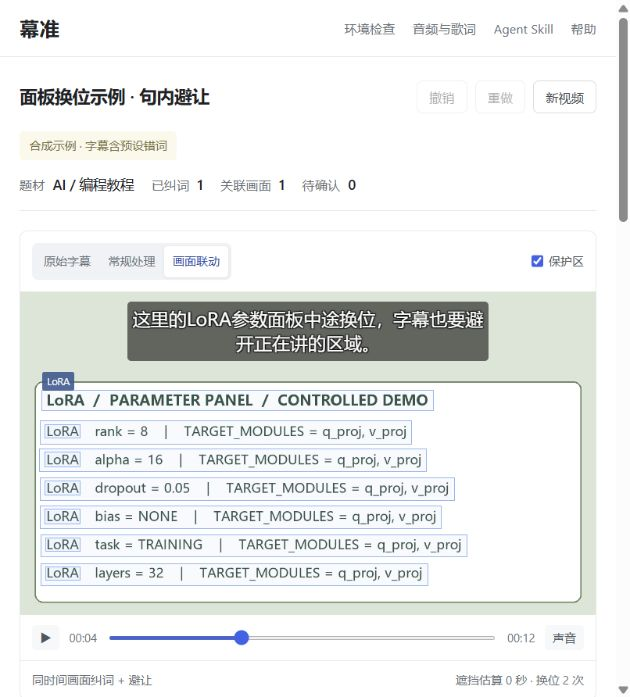

# Muzhun

**Local subtitles with screen-linked terminology and focus-aware placement.**

Transcribe a video, check technical terms against nearby on-screen text, and place subtitles around the referenced regions. Generate editable SRT / ASS and rendered MP4. Audio supports line-timed LRC / SRT, waveform seeking, splitting, merging, and timing edits. The same engine works through an Agent Skill.

[Downloads](https://github.com/senlinlangqian-png/muzhun/releases) · [中文](README.md) · [Skill instructions](skills/muzhun-subtitles/SKILL.md) · [Report an issue](https://github.com/senlinlangqian-png/muzhun/issues)



## Start

Requires **Python 3.10+; 64-bit Python 3.12 recommended**. Download the complete `muzhun-VERSION-source.zip` from Releases and extract it. On Windows, double-click `Start-Muzhun.cmd`; on macOS / Linux, run `sh run.sh`. Dependencies install on first launch; the selected speech model downloads on first transcription. A verified Noto CJK font is downloaded if no usable Chinese font is present.

The UI runs locally. No transcription API key or domain is required. This is a source distribution, not a standalone EXE or hosted processing service. Initial dependency/model/font downloads need internet access.

## Version 1.0

- Video up to **2 hours / 2 GB**; audio up to **2 hours / 512 MB**.
- Short recognition chunks with overlap context, global timestamps and completed-chunk reuse after interruption.
- Speech and song modes, language selection, technical vocabulary, and model quality options.
- Waveform seeking, line split/merge/delete, undo/redo, and range-limited lyric re-alignment using observed word anchors.
- Local originals, evidence and human review state remain available. Unresolved timing is never filled by distributing lines evenly.
- One setup command prepares both the Python engine and a selected Agent Skill.

## Agent Skill

```sh
python scripts/setup.py --agent codex
```

Windows also provides `Install-Skill.cmd`. Supported installer targets: `codex`, `deepseek`, `claude`, `cursor`, `gemini`, `opencode`, `kimi`, `agents`. Use `--destination` for a custom skill directory. The host must support local file access and Python execution; model-only chat sessions cannot execute this engine. Installer/launcher checks do not imply full-session testing in every host.

```text
Use $muzhun-subtitles to subtitle this video. Check technical terms against
on-screen evidence, protect important regions, and deliver an MP4, editable
subtitles, and a list of unresolved wording or timing.
```

The standalone Skill ZIP **does not include the engine, dependencies or speech models**. First-time users should install from the full source ZIP. See [CLI reference](skills/muzhun-subtitles/references/cli.md).

## Scope and validation

On-screen association uses sampled OCR, not arbitrary object tracking. At most 600 frames are sampled, so a two-hour video has roughly 12-second gaps. Fast scene changes can be missed. Domain presets cover AI/programming, CS2 and Valorant; other content can use general mode and a custom glossary.

Singing/lyric alignment is experimental. Synthesized singers, accompaniment, harmonies and sustained notes may produce wrong words or unresolved lines. Supplying correct lyrics preserves their text but cannot guarantee timing. There is no word-by-word karaoke highlighting.

Actual ASR/OCR/render tests use original synthetic fixtures. Long-file checks establish pipeline behavior, not general accuracy or speed. Ordinary speech can still contain errors and needs listening review. Tests, provenance and limitations are recorded in [validation notes](docs/testing.md). This project does not claim global novelty.

```sh
python -m unittest discover -s tests -v
python scripts/verify_long_media.py --continuous
python scripts/build_release.py
```

## Stack and license

Built with faster-whisper, RapidOCR, PyAV, FFmpeg, FastAPI and OpenCC. Muzhun implements time-local evidence association, joint placement, resumable recognition, review/editing and delivery workflows. Original code is MIT; third-party dependencies, models and fonts retain their own licenses. User media, runtime paths, model caches and system fonts are excluded from public archives.
