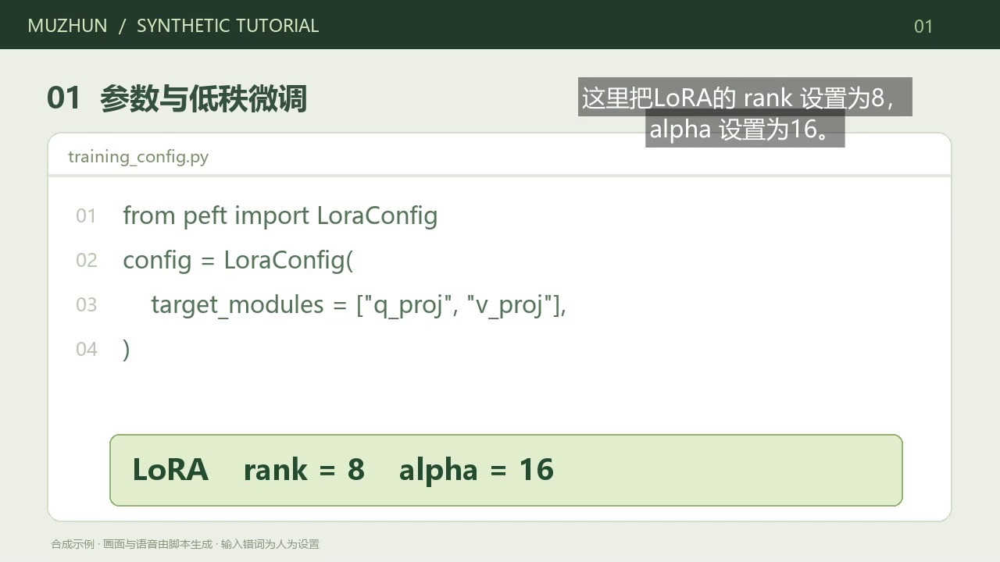
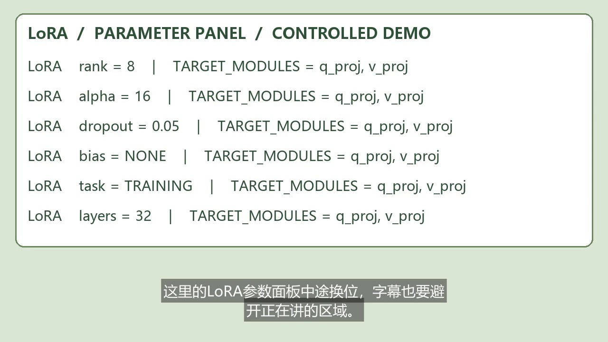
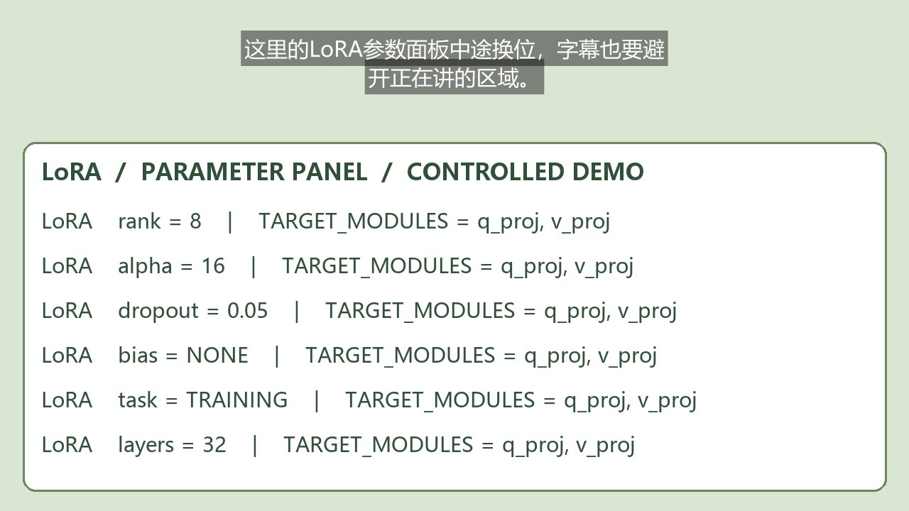

# 幕准 Muzhun

**术语写对，讲哪不挡哪。**

给 AI、编程教程与游戏教学视频使用的本地字幕工具，附带 Agent Skill。参考同一时间的画面文字核对术语，把正在提到的词关联到画面区域，再安排字幕位置。保留原文、纠词依据与手动修改入口。

当前为 **0.7.0 公开测试候选版**。视频支持术语与画面联动避让；音频支持自动转录、逐行 LRC/SRT、简繁处理和补充原歌词后重对齐。配套 Skill 可交给本地 Agent 调用。歌曲原词对齐仍是实验功能，遇到虚拟歌姬、伴奏和拖音可能大量未定位。更新内容见 [CHANGELOG](CHANGELOG.md)，朋友先看 [试用步骤](docs/friend-test.md)。

普通用户先看 [第一次使用](docs/quickstart.md)。网站在你的电脑运行；有本地执行能力的 Agent 可以另装 Skill。字幕引擎无需域名或 API Key。当前是源码版，需要 Python；尚未提供免安装 EXE，亦未部署公网视频处理服务。




图为合成素材的实际 MP4 导出帧。标题和下方参数保留可见，字幕安排在右上方。可先体验内置演示，再使用自己的素材检验效果。

换位示例：页面点击“字幕避让”，选择“画面联动”，展开右侧“字幕位置”，点击 0.20–4.00、4.00–8.00、8.00–11.80 秒，观察字幕在下方 → 上方 → 下方切换。也可把“避让方式”切为“每句固定位置”进行同文字对照。以下两帧均来自实际导出的合成视频：




## 运行

Windows 64 位，安装 Python 3.10 或更新版本（推荐 3.12），解压后双击 **Start-Muzhun.cmd**。也可以运行：

~~~powershell
.\run.ps1
~~~

启动器自动创建环境并安装处理依赖，服务就绪后打开浏览器。实际地址显示在启动窗口；端口 8770 被占用时改用下一个空闲端口。首次安装会下载依赖；首次语音识别会下载所选 Whisper 模型。内置示例或提供 SRT 时不需要语音模型。处理阶段在本机运行，不需要 API Key。首次依赖下载需要联网；运行时不依赖 Codex 自带的 Python。

macOS / Linux：安装 Python 和可用中文字体后运行 `sh run.sh`。本次已实测 Windows；其他系统有启动脚本和 CI 配置，尚未取得实机或远程 CI 结果。

手动安装：

~~~powershell
python -m venv .venv
.\.venv\Scripts\python.exe -m pip install -e ".[dev]"
.\.venv\Scripts\python.exe -m muzhun.cli doctor --full
.\.venv\Scripts\python.exe -m muzhun.cli serve
~~~

Linux / macOS 使用对应的 .venv/bin/python。安装 Noto Sans CJK 或使用系统中文字体；也可将 MUZHUN_FONT 设为中文字体文件绝对路径。项目没有分发微软字体。

自定义字体用于本机测量与视频合成，不放入交付 ZIP。其他编辑器需要安装相同或兼容字体才能重现 ASS 的排版；MP4 保留合成后的可见效果。

[requirements-tested-windows.txt](requirements-tested-windows.txt) 保存本次 Windows / Python 3.12 的依赖版本，供复现实验使用；跨平台安装以 pyproject.toml 为准。

## 当前能力与范围

- 音频自动转录为逐行 LRC/SRT，或导入已有 LRC/SRT。中文自动转录默认输出简体，同时保留识别原文；提供的歌词保持原样。识别后可以补充完整歌词，复用已保存的逐词锚点重新对齐并撤销，避免为改字重复识别。0.6 旧记录没有逐词缓存，需要重新上传才能按纯文本重对齐。
- 歌词可逐句试听、设置起止、整体偏移、显示识别锚点、跳到下一句待复核。简繁在匹配时统一，显式“转为简体”保留原文并支持撤销。未匹配行保留空时间，补齐后才能导出完整字幕；署名、外文片段和低可靠识别提示只供复核，不自动删除文字。
- 歌曲原词对齐是实验功能。文本匹配覆盖率不是时间准确率；重伴奏、拖音、和声和虚拟歌姬可能造成大量未定位。当前不是针对演唱训练的强制对齐模型，也不提供逐字卡拉 OK 高亮。真实歌曲试用中的已知失败见 [验证记录](docs/testing.md)。
- 上传不超过 250 MB、10 分钟的视频；建议先用 30–60 秒短片。
- 自动识别 AI / 编程、CS2、无畏契约，依据不足时进入通用模式；可手动指定。
- 本地语音识别，或导入已有 SRT。默认 Small；Base 用于快速试用。画面中可核对的术语作为识别热词，记录在 asr.screen_hotwords。
- OCR 保存画面文字、截图、真实帧时间和矩形坐标。
- 画面支持明确错写时采用修正；近似拼写或仅有词表支持的建议保留待确认。
- 将字幕提到的术语或界面标签与同时出现的区域绑定，并合并同排相邻参数文字；游戏另有可修改的 HUD / 准星保护预设。
- 排版同时考虑遮挡、阅读行数、短末行、常用位置和位置变化。C 支持句内分时避让：位置至少保持 1.2 秒，只有当前遮挡明显降低时才换位；安全位置不会仅为返回下方而跳动。短暂闪现可能仍有遮挡提示。
- 位置时间线可逐段跳转；切换整句固定 / 随画面避让。拖动字幕会锁定整句，恢复自动后重新计算。
- 三套样式、字体切换、字号调节、改文字与时间、拖动字幕、手动画保护区。
- 搜索字幕与原文，筛选未复核 / 已复核 / 纠词或遮挡提示；“试听本句”播放到该句末尾即暂停。
- 批量改词先展示每句前后对照，只应用勾选条目。默认完整英文词匹配，不把 `LoRA2`、`my_LoRA` 当作 `LoRA`；中文按文字匹配。
- 保存前离开当前字幕会提醒；已保存操作可撤销 / 重做 30 步。复核记录与历史随任务保存，重新打开仍可用。
- 人工复核绑定当前 C 模式文字、时间和位置；修改影响哪句，就取消哪句的旧标记。待确认纠词需先采用或保留原词；“已复核”是使用者填写的记录，不是自动正确率。
- 下载纯文本 SRT、保留位置与样式的 ASS、合成 MP4、处理记录；完整交付 ZIP 附逐条复核页和从实际导出视频提取的截图。
- 生成随机匿名的 A/B/C 三组视频、离线播放评分页和 CSV；朋友解压后双击 index.html 即可测试，对照表留在作者侧。

当前尚无任意画面对象检测、任意专业知识校验、说话人追踪或复杂花字动画。画面模糊、没有可见术语、快速变化、陌生游戏和口音会影响效果。游戏保护矩形是预设，尚未覆盖所有分辨率和 UI 模式。

## 本项目的工程机制

1. **时间约束的纠词证据**：术语表给出候选，附近画面提供可查看的拼写依据。画面文字不能证明音频一定说了该词，仍需检查。
2. **词—时间—区域关联**：纠正后出现的术语或标签与同时间的画面文字绑定，产生重点保护区。
3. **联合布局**：文字修正影响行宽、行数和占位；绑定区域提高遮挡代价；动态规划结合观察时段、持续时间与位置保持，在句内及连续字幕间平衡遮挡与稳定。
4. **验证入口**：A 原始字幕固定位置；B 全片词表纠词与一般 OCR / 游戏预设避让分别处理；C 限定时间的证据和讲解区域共同参与。B 是本项目实现的对照，不代表所有现有产品。

这是待验证的工程贡献，**不宣称首次提出或全球唯一**。A/B/C 共用初始字幕和字体设置。手动修改 C 后的结果适合生产，不应与未经编辑的 A/B 作为纯算法对照。

换位依据来自抽样 OCR，不是对象追踪。素材通常每秒抽一帧，长片会降低频率；变化可能滞后一个抽样间隔。限时手动区域在 C 自适应模式按起止时间生效。应检查移动前后的字幕和重要内容，特别是快速游戏画面。

未提供 SRT 时，三组共用含画面热词提示的同一份识别结果；A 不是无提示音频模型的独立基线。热词对识别的贡献需要额外比较提示开关。

## Skill

网站、字幕引擎、Skill 是三个入口层次。网站让人上传、查看、拖动和导出；Python 引擎负责识别、证据关联、排版与渲染；Skill 让 Agent 按任务调用引擎、读取证据、检查真实输出并交付文件。只做网站可以成为可用产品。Skill 规范的核心是带名称、触发描述和操作说明的 SKILL.md；脚本、参考资料和显示配置可选。幕准的字幕任务需要实际执行处理，因此另外提供脚本入口和运行环境安装方法。官方格式参见 [OpenAI Skill 文档](https://learn.chatgpt.com/docs/build-skills)。

技能位于 [skills/muzhun-subtitles](skills/muzhun-subtitles/SKILL.md)。Windows 安装到本机：

~~~powershell
.\install-skill.ps1
~~~

重新加载技能列表后使用：

~~~text
使用 $muzhun-subtitles 处理我提供的视频，核对游戏或专业术语，
保护讲解区域，交付视频、可编辑字幕和复核页，列出未确认的问题。
~~~

Skill 目录包含 SKILL.md（何时使用、如何操作和核查）、scripts/run.py（程序入口）、references（命令与评测约定）、agents/openai.yaml（显示信息）。Skill 调用同一 CLI，可处理视频或音频歌词、修改结果、导出与评测。只安装 SKILL.md 不等于安装了运行环境；先运行 run.ps1 或执行安装命令。默认安装到 Codex；其他 Agent 用 --agent 选择目录。

DeepSeek Harness 运行 `.\install-skill.ps1 -Agent deepseek`；Claude Code / Cursor 分别用 `-Agent claude` / `-Agent cursor`。它们输入 `/muzhun-subtitles`，Codex 用 `$muzhun-subtitles`。Gemini CLI、OpenCode、Kimi Code CLI 分别用 `-Agent gemini`、`-Agent opencode`、`-Agent kimi`，然后让 Agent“使用 muzhun-subtitles 技能”。具体目录、朋友可复制的任务与实际验证范围见 [朋友试用](docs/friend-test.md)。

同一份 Skill 调用同一个本地引擎，模型品牌不决定能否运行。Agent 需要能读文件和执行 Python；只把 Skill 上传给没有执行环境的聊天网页，无法运行字幕处理。安装目录适配不代表所有 Agent / 模型组合已实测。

更新本机已安装版本用 `.\install-skill.ps1 -Update`。macOS / Linux 使用 `.venv/bin/python scripts/install_skill.py --agent deepseek` 等，更新时加 `--update`；也可用 `--destination` 指定技能目录。`dist/muzhun-subtitles-skill-0.7.0.zip` 可单独分发技能；它不包含引擎、模型或本机路径记录，需配合源码包安装处理环境。移动项目后重新安装 Skill，或设置 MUZHUN_HOME 指向新环境；显式设置优先于旧记录。

`doctor` 逐项显示依赖、视频合成、中文字体、结果目录与缓存模型，提供修复提示且不下载语音模型。`doctor --full` 额外实际加载识别引擎。网页右上角“环境检查”提供首次试用入口；未缓存语音模型时可以先体验内置示例。

## 命令行

~~~powershell
# 一条命令：识别、排版、视频、字幕与复核页
.\.venv\Scripts\python.exe -m muzhun.cli deliver video.mp4 --out outputs\my-video

# 使用已有字幕
.\.venv\Scripts\python.exe -m muzhun.cli process video.mp4 --srt subtitles.srt --out outputs\my-video

# 音频自动生成逐行歌词草稿；中文默认简体，可用 --script original 保留字形
.\.venv\Scripts\python.exe -m muzhun.cli lyrics audio.mp3 --out outputs\my-lyrics --language zh

# 识别后补充原歌词，不重跑识别；revision 使用处理记录当前的数值
.\.venv\Scripts\python.exe -m muzhun.cli lyrics-align outputs\my-lyrics\lyrics-result.json --text lyrics.txt --revision 0

# 喜欢每句固定一个位置时，切换 C 的策略
.\.venv\Scripts\python.exe -m muzhun.cli process video.mp4 --srt subtitles.srt --out outputs\fixed --position-policy static

# 直接识别语音
.\.venv\Scripts\python.exe -m muzhun.cli process video.mp4 --model small --out outputs\my-video

# 合成联动结果视频
.\.venv\Scripts\python.exe -m muzhun.cli render outputs\my-video\result.json

# 复用已有识别结果，重新生成完整交付包
.\.venv\Scripts\python.exe -m muzhun.cli package outputs\my-video\result.json

# 批量改词先预览，不写入文件；确认后加 --apply，并传预览返回的 --revision
.\.venv\Scripts\python.exe -m muzhun.cli replace outputs\my-video\result.json --find "罗拉" --replace "LoRA"

# 查看逐句复核清单；人工检查后用 review --ids 标记
.\.venv\Scripts\python.exe -m muzhun.cli review outputs\my-video\result.json

# 恢复上一项已保存修改
.\.venv\Scripts\python.exe -m muzhun.cli undo outputs\my-video\result.json

# 生成朋友盲测包
.\.venv\Scripts\python.exe -m muzhun.cli blind-pack outputs\my-video\result.json

# 使用人工标注评测
.\.venv\Scripts\python.exe -m muzhun.cli evaluate outputs\my-video\result.json --annotations truth.json
~~~

SRT 主要保存文字和时间；本工具的位置信息保存在 ASS。视频合成后可直接分享。CSV 评分表就是可以用 Excel 打开的表格。

## 验证

本机已通过 140 项自动检查；0.7 新增 15 项，覆盖简繁匹配、原文保留、锚点复用、重对齐撤销、旧历史迁移、时间点锚点、无依据不填时间、失效复核与 API 下载。原创合成朗读验证程序链路；真实虚拟歌姬歌曲只验证工作流，33 行原词中仅 8 行通过当前定位条件，25 行仍需手工处理。原文完整保留不代表时间准确，未进行独立精度标注。详见 [验证记录](docs/testing.md)。

用户反馈已在 Codex 调用自己的 Skill 处理歌曲。DeepSeek 适配验证了安装与启动器执行，朋友 Harness 完整会话仍待检验；macOS / Linux 尚未实机验收。机制和简历表达见 [工程导读](docs/implementation.md)。

录 6 段短视频，用 3 段调试，另外 3 段留作验收。请熟悉内容的人填写 annotations-template.json 的正确术语和重点区域，不要把系统推断的矩形直接当作正确答案。

evaluate 统计独立标注的术语召回和遮挡时间，它不等于整句准确率。朋友评分表另记错词、误改、人工修改时间和再次使用意愿。工作台的遮挡估算只用于检查，不作为独立效果证据。

生成合成示例（Windows 自带 SAPI 语音，画面由脚本制作）：

~~~powershell
.\.venv\Scripts\python.exe scripts\make_demo.py
~~~

示例输入有**人为设置的错词**，用于验证处理链路，不是外部测试集或语音识别准确率评测。示例配有单独标注的目标矩形。

运行测试：

~~~powershell
.\.venv\Scripts\python.exe -m unittest discover -s tests -v
~~~

运行真实库链路的合成回归检查（包括语音识别、视频合成、匿名包）：

~~~powershell
.\.venv\Scripts\python.exe scripts\verify_demo.py --asr --blind
~~~

运行换位场景验证（Windows 生成系统朗读素材，实际 OCR 和渲染）：

~~~powershell
.\.venv\Scripts\python.exe scripts\make_dynamic_demo.py
.\.venv\Scripts\python.exe scripts\verify_dynamic_demo.py
~~~

已生成的真实 OCR 记录可加 `--reuse` 重做布局和渲染。`dynamic-truth.json` 的区域来自生成器事先定义的面板坐标，不使用引擎推断。报告同时给出固定 C、分时 C，以及在同一候选位置集合中用标注挑选的最佳固定位置；最后一项仅供评测，不是引擎预测。

## 集成技术与相关工作

- [faster-whisper](https://github.com/SYSTRAN/faster-whisper)：本地语音识别与词时间。
- [opencc-python-reimplemented](https://github.com/yichen0831/opencc-python)：中文简繁转换，使用 OpenCC 字典；第三方 Apache-2.0 许可证。
- [RapidOCR](https://github.com/RapidAI/RapidOCR)：画面文字与矩形。
- [PyAV](https://pyav.org/docs/stable/)：真实帧时间、视频解码。
- [FFmpeg](https://ffmpeg.org/) / [imageio-ffmpeg](https://github.com/imageio/imageio-ffmpeg)：视频合成。ASS 格式参见 [Aegisub](https://aegisub.org/docs/latest/ass_tags/)。
- [OCR-Enhanced Multimodal ASR Can Read While Listening](https://arxiv.org/abs/2601.18393)、[Speaker-following Video Subtitles](https://arxiv.org/abs/1407.5145)：相关研究。
- [Wave Subs](https://github.com/jason-jm/wavesubs)：术语表、画面 OCR 与编辑的相近工具。

没有复制上述项目的字幕应用代码。原创代码使用 MIT；第三方库、模型、字体和运行时二进制遵循各自许可证。暂定产品名未做品牌唯一性确认。

## 发布与贡献

遇到问题或有建议，在本仓库顶部点 **Issues → New issue**。已提供报错、功能建议和使用提问三种表单，作者会在同一条 Issue 下回复。如何提供有效样例见 [贡献指南](CONTRIBUTING.md)。目前优先完善专业术语准确与字幕避让，歌词对齐保留实验标记。

发布文件说明见 [0.7 公开测试候选说明](docs/release-0.7.md)，安装问题与复现材料见 [贡献指南](CONTRIBUTING.md)。生成发布包：

第一次上传 GitHub 可按 [网页上传步骤](docs/github-upload.md) 操作。

```text
python scripts/build_release.py
```

以上命令使用安装了开发依赖的项目解释器。先打包公开源码，再从新的解压目录构建 wheel，避免旧构建残留；逐字节核对包内源码与资源，并检查 GitHub 网页上传数量和大小限制。生成版本化源码 ZIP、Skill ZIP、wheel 和 SHA256SUMS.txt，排除本机运行路径、模型、输出与虚拟环境。GitHub 发布时只使用此项目目录，勿混入父目录的旧项目。准备好的本地发布文件不代表已经上传 GitHub。
