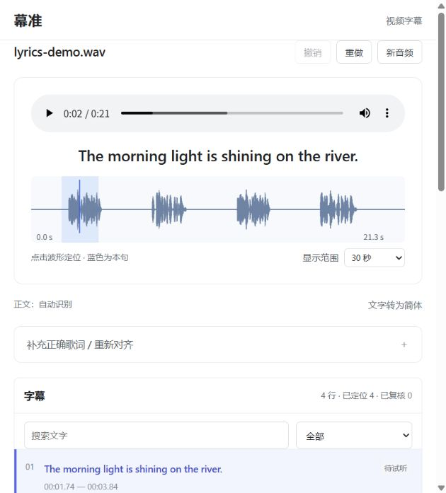

# 幕准 Muzhun

**给视频加字幕，术语有依据，重点不遮挡。**

本地字幕工具，也是一套 Agent Skill。把视频交给幕准，自动识别语音；参考同时出现的画面文字核对专业术语，让字幕避开正在讲解的区域。音频也能生成 SRT / LRC，并在波形上试听、改字和调时间。

[下载发布包](https://github.com/senlinlangqian-png/muzhun/releases) · [第一次使用](docs/quickstart.md) · [给 Agent 安装](#agent-skill) · [反馈问题](https://github.com/senlinlangqian-png/muzhun/issues) · [English](README.en.md)

当前源码版本 **1.0.0**。下载附件的版本以 Releases 页面为准。本项目在你的电脑处理素材；无需购买域名或填写字幕服务 API Key。**需要 Python 3.10+，推荐 64 位 Python 3.12；目前没有免安装 EXE。**


截图使用原创合成演示素材。画面文字、避让区域与导出字幕均来自实际程序输出。

## 1.0 更新了什么

| 你要做的事 | 幕准提供的入口 |
| --- | --- |
| 给课程、教程或游戏录像加字幕 | 上传视频，选语言与识别质量，自动转录、编辑、导出带字幕 MP4 |
| 处理更长的文件 | 视频最高 **2 小时 / 2 GB**，音频最高 **2 小时 / 512 MB**；分段识别并缓存进度 |
| 识别中途失败 | 原任务点“重试”，复用已经完成的识别片段；无需从头识别全部音频 |
| 改歌词的错字与时间 | 波形点击定位、逐句试听、拆句、合并、整体偏移、撤销与重做 |
| 提供正确歌词重新对齐 | 复用保存的真实逐词时间；重复副歌可限定音频范围重找本句 |
| 在 Agent 里直接使用 | 一个安装入口同时准备字幕引擎和所选 Agent 的 Skill |

中文识别默认转为简体，原始识别文字仍可查看。数字断句保护避免把 `0.001` 拆成两条字幕。模型低置信词和分段边界补回的词会提示试听；提示不是准确率判断。

## 最快开始

1. 从 [Releases](https://github.com/senlinlangqian-png/muzhun/releases) 下载 `muzhun-版本-source.zip`，**完整解压**。
2. Windows 双击 **Start-Muzhun.cmd**，等浏览器打开。首次会联网安装依赖；首次识别才会下载所选模型。
3. 上传视频，保留 Small 或选择更精细的模型，点击 **自动生成字幕**。先用短片试一下自己的设备和素材。
4. 试听核对需要修改的句子，检查位置，然后导出视频或字幕。

macOS / Linux 运行 `sh run.sh`。启动器会检查中文字体；缺少字体时下载经过 SHA-256 校验的 Noto Sans CJK。也可用 `MUZHUN_FONT` 指定自己的字体文件。关闭启动窗口会停止服务，保存的任务留在项目的 `outputs`。

**第一次只想看看效果？** 页面点“字幕避让”即可使用内置演示，不需要语音模型。完整步骤和安装排错见 [快速开始](docs/quickstart.md)。

## 音频与歌词

打开“音频与歌词”，选择 **说话 / 课程 / 播客** 或 **歌曲 / 歌词**。不填文字即可自动转录；已有 TXT、LRC、SRT 也可导入。SRT 用于视频剪辑；LRC 用于播放器逐行滚动歌词。



歌曲原词对齐仍是**实验功能**。虚拟歌姬、重伴奏、和声和拖音可能识别错误或无法定位。提供正确歌词能保留准确文字，但不保证时间正确；无法找到真实音频锚点的行保留空时间，不按歌曲长度平均分配。补齐后再导出完整字幕。当前没有逐字卡拉 OK 高亮。

## Agent Skill

Skill 是让 Agent 调用幕准的操作说明与脚本，**不是云端 AI 模型，也不要求先打开网页**。需要能读取本地文件、执行 Python 的 Agent；普通网页聊天框仅上传 Skill ZIP，不能自动拥有本地字幕引擎。

Windows 双击 **Install-Skill.cmd**，选择使用的工具。跨平台命令：

```sh
python scripts/setup.py --agent codex
```

将 `codex` 换为 `deepseek`、`claude`、`cursor`、`gemini`、`opencode`、`kimi` 或 `agents`。安装器使用对应用户技能目录；支持 `--destination` 指定 Harness 实际读取的目录。不同工具版本可能需要重新加载技能。已验证安装器与独立启动脚本，不代表每个 Agent 的完整会话都已实测。

在 Codex 中可以这样说：

```text
使用 $muzhun-subtitles 给这个视频自动加字幕。参考画面核对专业术语，
避开重要内容，交付 MP4、可编辑字幕和需要试听确认的清单。
```

在其他本地 Agent 中：

```text
使用 muzhun-subtitles 处理这个音频，生成 LRC 和 SRT。
这是歌曲；保留识别原文，列出未定位和需要试听的行。
```

Skill 文件在 [skills/muzhun-subtitles](skills/muzhun-subtitles/SKILL.md)。**单独的 Skill ZIP 不含引擎、依赖或模型**；首次推荐完整源码包并运行安装器。[朋友试用和各 Agent 安装](docs/friend-test.md) · [命令与编辑格式](skills/muzhun-subtitles/references/cli.md)。

## 术语和位置为什么要联动

幕准先在字幕附近的画面中寻找术语拼写，再把字幕提到的词关联到对应矩形。修正后的文字宽度、讲解区域和位置稳定性共同参与排版；重要区域变化时，允许同一句字幕分时换位。界面可以查看证据、保留原词、手动保护区域和恢复自动位置。

换位依据是抽样 OCR，**不是任意物体追踪**。长视频最多抽取 600 帧，2 小时视频约每 12 秒一帧，快速切镜和游戏运动可能漏检。自动领域选择只覆盖 AI / 编程、CS2、无畏契约的规则，其他内容可使用通用模式和自定义术语。没有可见文字时，不能凭画面证明普通错字或任意专业知识。

这是一项可复现的工程整合与改进，**不宣称全球首创或没有同类项目**。A/B/C 对照和独立标注评测入口保留在工具中；手动编辑过的结果不应冒充纯算法效果。

## 验证与已知限制

1.0 的测试与复现记录见 [验证记录](docs/testing.md)，包括自动检查、全新源码目录安装、实际 OCR / ASR / FFmpeg、长文件和浏览器编辑下载。两小时样例以静止画面和长静音为主，验证长文件流程；连续讲话另外使用原创合成朗读检查。它们都不是口音、噪声、真实课堂或歌曲的普遍准确率。

普通词仍可能误识别，例如中文合成样例中的“示例”识别成“势力”。更大的模型、正确语言和术语表可供选择，但不能保证消除错字。真实歌曲的历史试用曾有 33 行中 25 行未定位，不能以文字完整保留宣称歌词时间已经解决。导出时保留未复核状态，供你决定怎样交付。

开发者检查：

```sh
python -m unittest discover -s tests -v
python scripts/verify_long_media.py --continuous
python scripts/build_release.py
```

以上命令在已安装开发依赖的环境运行；长文件检查会实际调用模型并渲染视频，不属于普通单元测试。

## 技术与反馈

识别使用 [faster-whisper](https://github.com/SYSTRAN/faster-whisper)，画面文字使用 [RapidOCR](https://github.com/RapidAI/RapidOCR)，音视频解码与合成使用 [PyAV](https://pyav.org/) 和 [FFmpeg](https://ffmpeg.org/)，简繁转换使用 [OpenCC 的 Python 实现](https://github.com/yichen0831/opencc-python)。本项目实现时间约束的证据关联、联合排版、分段缓存、编辑复核、交付与 Skill 调用。相关工作和工程结构见 [工程导读](docs/implementation.md)。

遇到安装失败、错词、遮挡或功能建议，点 **[Issues → New issue](https://github.com/senlinlangqian-png/muzhun/issues/new/choose)**；作者会在同一条 Issue 回复。请只上传愿意公开的样例。[贡献指南](CONTRIBUTING.md) · [更新记录](CHANGELOG.md) · [1.0 发布说明](docs/release-1.0.md)。

原创代码使用 [MIT](LICENSE)。依赖、模型、字体与运行时二进制分别遵循各自许可证；发布包不包含用户素材、模型缓存、私人运行路径或系统字体。
