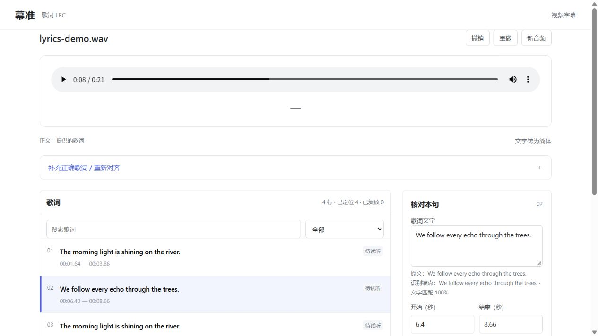
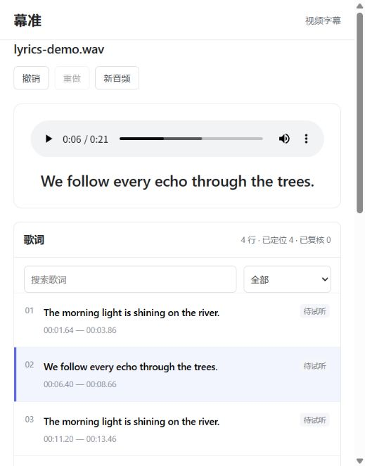
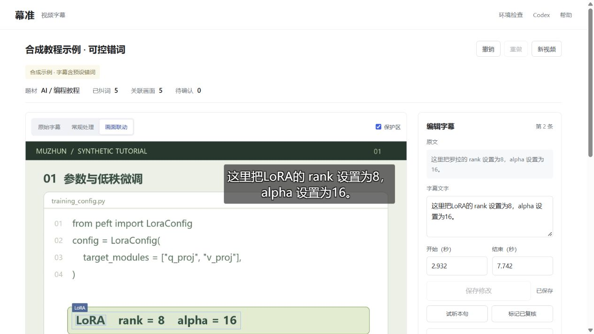
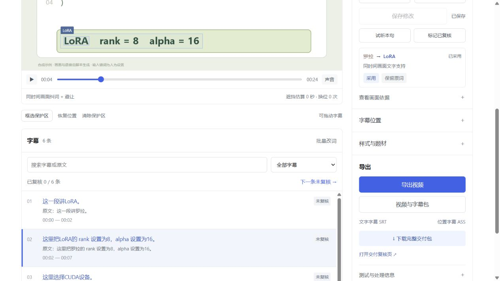
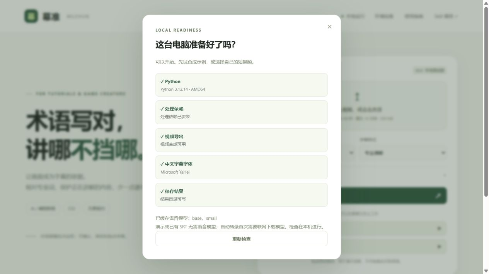
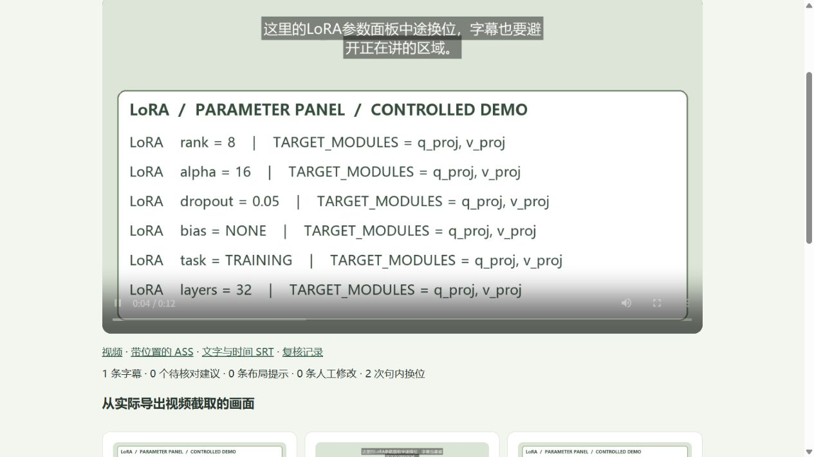
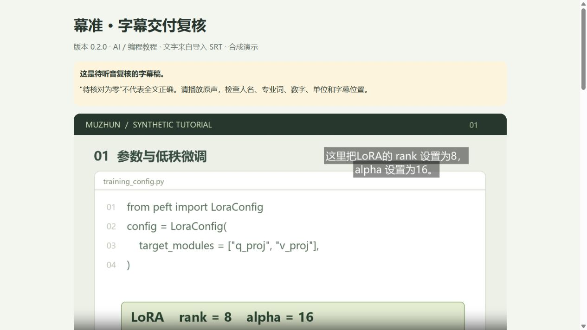

# 1.0.0 验证记录 · 2026-10-13

当前本机通过 **173 项自动检查**。检查覆盖长文件时间范围、分段边界、已完成片段复用和损坏缓存恢复、低可靠词提示、简繁原文保留、歌词拆合/撤销/范围对齐、波形有限读取、接口重试与修订隔离、字体校验及 OCR 复用。Skill 格式、前端 JavaScript 语法与 Python 依赖一致性检查通过。Windows 远程检查发现 cp1252 重定向输出无法显示中文，安装器与独立 Skill 启动入口已统一 UTF-8，并增加重现检查。

## 实际运行

| 材料 | 做了什么 | 结果与边界 |
| --- | --- | --- |
| 原创 12 秒换位示例 | 真实 OCR、独立定义的面板坐标、ASS 与 MP4 | 下方→上方→下方；本样例自适应遮挡 0 秒，最佳固定位置标注对照 4 秒；限受控样例 |
| 原创中文 24.562 秒合成朗读 | 不提供 SRT，Small 识别、画面术语提示、视频交付 | 6 句，LoRA / CUDA / PyTorch 保留；小数 0.001 不再拆句；“示例”仍误听成“势力”，一个人名建议保留待确认 |
| 原创英文 21.25 秒合成朗读 | 浏览器上传、识别、波形、拆句、合并、撤销与下载 | 四句均有真实时间；浏览器下载的 LRC、视频 ZIP 与对应导出逐字节相同；未冒充人工复核 |
| 原创 11 分 2 秒连续重复朗读 | 无 SRT，真实 ASR、27 个短片段、600 帧与视频合成 | Small（默认）：961 个参考词，8 次词编辑，WER 0.83%；Base：63 次、6.56%。这是开发样例，不是普遍准确率 |
| 完整两小时文件 | 无 SRT、288 个识别片段、600 帧、MP4 交付 | 最后一句起点 7194.25 秒；保留音轨和尺寸，时长差 0；以静止画面和长静音为主，93 个参考词本次 0 词编辑 |

连续朗读是同一段原创合成语音的重复，用于暴露长调用漂移和边界问题，**不是独立真实测试集**。开发过程中 5 分钟调用加默认随机回退曾出现 473/961 次词编辑；关闭随机回退、缩短含上下文窗口到不超过 29 秒后，同一材料的 Base 结果为 63/961。这个比较只描述此开发样例，不能外推为真实内容的准确率提升幅度。

两小时 Base 运行约 85 秒、连续 11 分钟 Base 运行约 79 秒，连续 Small 约 186 秒。都属于当前电脑的单次记录；两小时样例静音占绝大部分，不能宣传为任意两小时视频一分钟处理。原始结果中的计时包括 OCR、识别、布局与渲染，素材生成不计入。

浏览器检查还包括新版首页的可见开始按钮、真实波形点击定位、刷新恢复编辑历史、字幕视频交付下载；控制台未观察到错误。界面截图使用原创合成素材，未把用户的歌曲或个人任务放进公开包。

## 安装与跨平台

1.0 完整源码 ZIP 的新环境安装验证使用同一台 Windows 电脑的新中文/空格目录。验证统一 setup、重复运行不重装依赖、完整环境检查、独立 Skill 启动脚本、视频交付和 LRC 导出；本次已通过：1.0.0 环境 ready、第二次启动不重装依赖、DeepSeek 安装目标的独立脚本成功导出视频与 LRC；没有下载语音模型。

0.7 的 [三系统 CI](https://github.com/senlinlangqian-png/muzhun/actions/runs/38062816690) 已通过；**它不能代替 1.0 的 CI**。1.0 远程结果请查看本版修改提案的 Checks 和对应提交的 Actions，不能引用旧版运行充数。宿主安装目录和脚本执行不代表所有 Agent 的真实模型会话均通过，也没有实测所有电脑与系统。

## 复现

在项目环境运行：

```sh
python -m unittest discover -s tests -v
python scripts/verify_dynamic_demo.py
python scripts/verify_long_media.py --continuous
python scripts/verify_long_media.py --continuous --model small --out .cache/v1-validation/continuous-small
python scripts/verify_long_media.py --duration 7200 --out .cache/v1-validation/two-hour
python scripts/verify_install.py --source dist/muzhun-1.0.0-source.zip
```

长文件命令会实际调用模型、写 WAV、抽帧并渲染，可能下载模型并占用空间；生成文件留在 .cache，不进入公开源码。完整包检查还核验 wheel 与当前源码逐字节一致、ZIP 完整性、敏感目录/运行路径排除和 SHA-256。检查通过只证明所述范围，不证明歌曲或任意口音准确。

歌曲时间对齐仍为实验功能，历史真实虚拟歌姬试用的 33 行中 25 行未定位。1.0 增加可用的编辑与限定范围重找入口，没有将这次真实失败改写为成功。更多真实课堂、口音、噪声、游戏录像和朋友设备的验收需要公开或获得授权的独立样例。

下面保留各历史版本的记录；其中“尚未发布/尚未 CI”描述的是当时状态。

---

# 验证记录

最新验证日期：2026-10-10。环境：Windows，本地 Python 3.12.14，CPU int8 语音识别。受控验证使用项目自己生成的合成视频与原创文字的合成朗读；另复测了一首用户提供的真实虚拟歌姬歌曲。两者均不代替独立用户与跨设备测试。

## 0.7.0 的验证

- 全部 140 项自动检查通过。新增 15 项覆盖简繁匹配与原文保留、中文自动转录字形、其他语言保留、缓存重对齐、正文来源与复核撤销恢复、旧记录迁移、无缓存错误、版本冲突、零时长与越界锚点、识别异常提示、未定位时清除旧导出，以及实际上传 / 重对齐 / 下载 API。歌词 JavaScript 语法检查通过。
- 浏览器从 WAV 开始实际运行 Base 英语识别，再导入原创 TXT 并复用缓存对齐：四行全部有时间，重复句顺序保留。实测撤销恢复自动识别来源、重做恢复提供的歌词来源，刷新保留修订。样例为合成朗读，不能据此宣称歌曲时间准确。
- 浏览器导入自编繁体 LRC，显式转为简体后原文仍可查看；撤销恢复繁体，再撤销恢复英文演示。下一句待复核跳到第二句，试听实际停在 8.66 秒。浏览器下载 LRC 为 261 字节，与本机该修订文件逐字节一致；演示人工复核数保持零。
- 私有虚拟歌姬歌曲约 259.657 秒，实际运行 Small 中文识别，并用用户提供的完整 33 行原词重对齐。只获得 8 行有效时间，25 行仍未定位，所有原词完整保留，完整导出被阻止，没有伪造时间。对分段与静音设置的试验没有改善结果，已撤回该设置改动；没有声称提高这首歌的识别准确率。原始用户任务保留，歌词、音频与识别缓存不进入公开包。
- 用户反馈自己已在 Codex 中调用该 Skill 并得到可用草稿。这是一例使用反馈，没有人工时间真值或系统准确率评分；DeepSeek Harness 仍需在真实模型会话与朋友设备验证。
- 源 Skill 与本机安装副本格式检查通过，Codex 安装副本同步为 0.7.0。通过安装后的启动器实际运行新 `lyrics-align` 命令，从缓存重对齐四行原创英文歌词，未重跑识别。原环境依赖一致性检查通过。
- 发布前补充 Gemini CLI、OpenCode、Kimi Code CLI 目录适配。分别在本机隔离目录通过 PowerShell 安装入口安装，再实际运行各副本启动器导入 LRC，各导出 66 字节文件；没有安装或调用这三款 Agent 的真实模型会话。涉及安装与歌词的原有 34 项检查再次通过，未为目录映射增加重复测试。三类 Issues 表单已解析并检查必填项与字段 id。
- 将 0.7.0 源码 ZIP 解压到新的中文与空格目录，用已有 Python 建立全新环境，包含 OpenCC 依赖。完整 doctor 成功、缓存语音模型为空，第二次启动未重复安装。按 DeepSeek 目标安装独立 Skill，并实际调用启动器导出 281,638 字节视频与 66 字节 LRC。这是同一台 Windows 电脑的新目录验证，提供 SRT / LRC 的部分不运行 ASR，不代替朋友电脑与 Harness 会话。
- 源码 ZIP、独立 Skill ZIP、wheel 的完整性、必需资源与版本均检查；wheel 从解压后的源码包构建并逐字节核对当前资源，生成 SHA-256。公开源码共 104 个文件，网页上传分为不含 docs 和完整 docs 两批，各批数量及单文件大小均检查。发布包排除私有歌词、音频、处理结果、环境记录和缓存；本地准备不等于 GitHub 已发布。



歌曲原词对齐是实验功能。当前使用 ASR 词级时间做文字匹配，不是演唱专用强制对齐器；文字匹配比例、已定位数量与人工复核数量分别展示，均不自动等同于字幕准确率。

可复现首次安装检查：`python scripts/verify_install.py --source dist/muzhun-0.7.0-source.zip`。首次安装普通依赖需要联网；检查日志只保留在本机。

## 0.6.0 的验证

- 全部 125 项自动检查通过。新增 22 项覆盖中英文歌词匹配、重复句顺序、缺失锚点保留空时间、文本覆盖率与人工复核分开、LRC 多时间标签与 offset、普通 SRT 导入、错误时间拒绝、修订冲突、撤销 / 重做、旧导出清除、歌词接口和 DeepSeek 安装目录。歌词 JavaScript 语法与源 Skill 格式检查通过。
- 用项目原创四行英文文字生成 21.251 秒合成朗读，加入开头、句间和结尾停顿。CLI 与浏览器分别运行实际 faster-whisper Base 识别，得到四行有时间的歌词草稿，两个重复句按出现顺序匹配，输入文字保持不变。样例是朗读而非演唱，不是歌曲对齐精度成绩；所有行的人工复核数保留为零。
- 浏览器实际上传 WAV 与 TXT、选择英语与 Base 模型、跳转重复句、逐句试听，试听在 13.46 秒句末停止。实测改字取消旧复核、撤销恢复文字与标记、刷新保留历史，以及撤销后重做。清空一行时间后导出入口不可用，补回时间后重新启用。
- 浏览器实际下载的 `lyrics.lrc` 为 261 字节，与本机该修订导出文件逐字节一致。普通 LRC 的百分秒格式、SRT 与 JSON 入口均保留；空行清屏事件的显示效果仍取决于使用的播放器。
- 在隔离目录按 DeepSeek 目标安装 Skill，使用安装后的 `run.py` 实际导入 LRC 并导出四行字幕。已经核对 Harness 官方的 Skill 目录与调用规则；没有在真实 Harness 模型会话内调用，也没有在朋友电脑验收。
- 将 0.6.0 源码 ZIP 解压到新的中文与空格目录，用已有 Python 创建全新环境。完整 doctor 成功，缓存模型为空，第二次启动未重复安装依赖；在该目录按 DeepSeek 目标安装独立 Skill 并调用启动器，实际导出 281,638 字节视频与 66 字节单行 LRC。此安装检查使用提供的 SRT / LRC，不计为语音识别测试；仍是同一台 Windows 电脑的新目录，不能代替朋友设备或真实 Harness 会话验收。
- 歌词时间输入显示到毫秒，保留未修改的原始时间精度；浏览器实测切换歌词不会因为显示取整误报未保存。列表按百分秒进位显示，避免出现 00:60.00。



当前算法使用语音识别的词级时间作为锚点，按提供歌词的顺序辅助匹配。不是针对演唱训练的强制对齐器，也不提供逐字卡拉 OK；伴奏、拖音、快唱和漏唱仍需真实素材试听。文本匹配覆盖率不能作为时间准确率或真人评分。

可复现首次安装检查：`python scripts/verify_install.py --source dist/muzhun-0.6.0-source.zip`。它新建独立目录，首次下载依赖需要联网；提供 SRT / LRC 的部分不下载语音模型，检查日志只保留在本机。

## 0.5.0 的验证

- 全部 103 项自动检查通过。新增 29 项覆盖完整英文词与字面替换、指定范围、预览不写文件、绑定与布局刷新、人工复核失效与撤销恢复、30 步历史、重启保留历史、旧修订拒绝、导出快照与失败恢复、Windows 临时占用的有限重试，以及 Skill 命令。
- JavaScript 语法通过；107 个 HTML id 无重复，106 个直接 JavaScript 元素引用均存在。三系统 CI 配置可解析，Actions 版本核对官方当前发布；远程 CI 尚未运行。
- 浏览器实跑新的“字幕避让”与“术语纠错”示例，均运行实际 RapidOCR 并使用提供的 SRT。逐句试听停在 11.8 秒句末；测试复核按钮、批量替换的勾选范围、撤销 / 重做、刷新后恢复记录。标记仅用于验证操作流程，未冒充独立真人评分。
- 批量临时将 LoRA 改成 QLoRA，验证画面绑定从有到无、旧复核被取消；撤销恢复原文字、位置和对应复核，刷新后仍可重做。随后恢复演示文字。测试输入“自检：”前缀后采用 / 保留候选，确认不再清掉其他手工修改。
- 测试未保存输入的“继续编辑”和“保存并继续”；搜索 PyTorch 仅显示两条；问题筛选找到待确认人名候选，确认不能直接标成已复核。保留人名原词后“下一条未复核”跳到后续字幕，筛选也随之恢复可见。
- 实际导出中发现 Windows 读写记录短暂占用，以及读取失败导致进度停止的问题；增加原子替换 / 读取的有限重试和进度重连后重新导出。页面自动显示下载入口，浏览器实际下载的 ZIP 与本机交付文件逐字节一致。
- 导出 6 条字幕的 `delivery-C-r1.zip`，547,363 字节；1280×720，音轨保留，时长差 0.007 秒。复核页显示 v0.5.0、修订 1 与人工复核 0/6，三个预览由实际 MP4 解码。零待确认没有被当作全文已复核。
- 源 Skill 与安装副本格式检查通过，运行环境记录同步为 0.5.0；通过已安装 Skill 的 run.py 实际读取新的逐句复核清单。依赖检查正常，完整 doctor 成功，不下载新语音模型。
- 将 0.5.0 源码 ZIP 解压到新的中文与空格目录，用已有 Python 创建全新环境；完整 doctor 成功，语音模型缓存为空，第二次启动未重复安装依赖。在该目录安装独立 Skill 并实际执行 deliver，运行 OCR 与字幕合成，得到 281,638 字节 MP4。仍是同一台 Windows 电脑上的全新目录验证，没有据此声称其他设备已通过。
- 公开包仅含源码、说明、Skill、测试与合成示例；发布构建从源码 ZIP 的新目录生成 wheel，并逐字节核对资源，避免旧文件残留。GitHub 上传教程同步为 0.5.0；本机准备不代表已经公开发布。




以上是同一台 Windows 电脑上的受控素材功能验证，不是语音识别准确率、真实用户效果或跨设备验收。

在已安装幕准的项目环境可复现首次安装检查：`python scripts/verify_install.py --source dist/muzhun-0.5.0-source.zip`。它新建独立验证目录并保留本机日志，首次下载依赖需要联网；使用提供的 SRT，不下载语音模型。

## 0.4.1 的验证

- 原有 74 项自动检查再次通过；本次未修改字幕算法。网页所有 83 个直接 JavaScript 元素引用均存在，HTML id 无重复，JavaScript 语法检查通过。
- 浏览器实测单栏上传入口、折叠选项和简化编辑区。运行“字幕避让”生成 0.4.1 处理记录，展开“字幕位置”，跳转到 4.03 秒检查中途换位；通过新的“导出视频”按钮生成 MP4，页面显示可下载链接。
- 实际导出文件分辨率与源文件一致，音轨保留，时长差 0.028 秒。此素材使用提供的合成 SRT，不能作为真实语音识别成绩。
- Python wheel 从源码 ZIP 的新目录构建，核对 HTML、CSS 和 JavaScript 与源码一致；已移除的旧样式文件不再进入该 wheel。本机 Skill 的运行环境记录更新为 0.4.1，源码与 Skill 包重新生成并检查。
- 增加 GitHub 网页上传步骤，上传目录仍只含代码、文档、Skill、测试与合成示例。本项目尚未上传 GitHub；连接账号和生成教程不代表发布成功。


## 0.4 的验证

- 74 项自动检查通过；新增覆盖升级后依赖安装、显式 MUZHUN_HOME 路径优先、实际占用端口的跳过与持续绑定、无效端口、不完整模型缓存、Turbo 模型的实际缓存仓库、环境失败时保留其他检查项、轻量健康接口、就绪后打开浏览器，以及 Skill 安装更新和保留附加文件。
- 将版本化源码 ZIP 解压到本机一个新的中文与空格目录，没有旧虚拟环境、模型或 outputs。用本机已有 Python 3.12.14，通过 Windows PowerShell 启动脚本创建环境、安装普通处理依赖；完整 doctor 成功，缓存语音模型列表为空。再次运行安装入口没有重复安装。原环境和新环境的 pip check 均通过，依赖版本快照同步更新。
- 在该新目录安装独立 Skill，再通过其 run.py 实际执行 deliver：读取提供的合成 SRT、运行 RapidOCR、布局、FFmpeg 合成、生成可编辑字幕与复核页。MP4 为 281,638 字节，分辨率与源文件一致，保留音轨，时长差 0.028 秒。这个流程不需要下载语音模型，不是 ASR 准确率测试。
- 本机运行 0.4 网页，实测环境检查弹窗的依赖、视频导出、中文字体、结果保存和模型缓存提示；用内置面板换位示例检查处理与工作区入口。JavaScript 语法、三系统 CI 配置的 YAML、源码与安装副本的 Skill 格式分别检查。
- 源码、Skill ZIP 和 Python wheel 检查必需资源、版本元数据、ZIP 完整性、本机路径与生成文件排除，并生成 SHA-256 校验和。Skill 安装副本已更新到 0.4。

以上首次安装仍在同一台电脑上完成，使用已有 Python；未实测 Python 官网安装过程、另一台 Windows 电脑或 macOS/Linux。三系统 CI 尚未在 GitHub 运行。当前可作为源码开源测试版试用，不能宣称免 Python 安装或所有设备已验证。



源码包的首次安装检查可复现：在已安装幕准的项目环境运行 `python scripts/verify_install.py --source dist/muzhun-0.4.0-source.zip`。它会在 .cache/release-tests 新建验证目录并保留本机日志，不上传日志或下载语音模型；首次依赖安装仍可能联网。

## 0.3 的验证

- 62 项自动检查通过。新增覆盖句内换位与整段覆盖、静止画面合并、防止短暂闪现造成跳动、安全位置保持、手动锁定整句、限时保护区、长时段证据保留、多位置导出时 SRT 不重复、复核页按 id 保留后续字幕、非法/非有限时间、手动保护区遮挡提示、短末行偏好和新示例 API。
- `dynamic-demo.mp4` 是 12 秒合成素材，提供的 SRT 人为设置“罗拉”别名。参数面板 4 秒换到底部、8 秒换回顶部；真值矩形由生成器预先定义，未复制 OCR / 绑定输出。实际抽取 12 帧，RapidOCR 识别 228 个文字框，未经手动编辑。
- 同一句 C 字幕在 0.2–4 秒下方、4–8 秒上方、8–11.8 秒下方显示，形成两个句内换位；SRT 只有完整的一条，ASS 有三个位置事件。实际 MP4 两个位置的文字与参数面板可见，长字幕选择更均衡的宽度，避免末行只剩少数字。
- 以标注面板任何部分与字幕相交计算时间：分时 C 为 0 秒，本项目固定 C 为 11.6 秒。为避免把不理想的固定算法当作唯一对照，另计算同字体/候选集合中使用标注挑选的最佳固定候选，为 4 秒。这个值仅用于评测，不参与引擎选位；结果限于此受控样例，不是整句准确率、真实游戏成绩或节省时间。
- 源视频 12 秒、1280×720；两种导出都保留音轨，时长差 0.028 秒。复核图从实际 MP4 解码，覆盖换位两侧。完整可复现记录见 `v03-controlled-results.json`。
- 网页旧记录重排保留既有文字与人工决定；新增一键换位示例、三个时段跳转、固定/自适应对照和交付复核流程。Skill 更新后调用同一入口，处理来源和多时段复核约定同步。
- 实际拖动第二时段的字幕，确认锁定整句并提示其他时段的遮挡；发现锁定会退回过宽换行后已修复，再恢复自动三段布局。复核图去重为三张，每张显示该帧的实际位置；浏览器实测复核页按时段跳转并播放 1280×720 视频。
- 本机已安装 Skill 实跑 `package` 与 `blind-pack`，生成未保留手动修改的三组匿名视频。批次 `4fccaa8d` 单独保存私有对照；页面三组视频能解码，评分留空，未冒充真人测试结果。网页下载文件与最终交付 ZIP 逐字节核对；源码与独立 Skill ZIP 检查完整性，独立解包的 Python wheel 检查版本、词表、网页及复核模板资源。



位置变化仍可能滞后一个抽样间隔。短暂闪现的测试刻意检查“保持原位且保留遮挡提示”，不能宣传成所有情况下均无闪烁或零遮挡。当前没有真实用户盲测成绩。

## 0.2 的验证

- 48 项自动检查通过。新增覆盖纠词候选变动后的旧决定迁移、清空时间覆盖与时间排序、单轨重叠拒绝、小标题遮挡代价、手动位置遮挡提示、数字行号和英文片段的误绑定、输出时长/音轨校验、HTML 数据转义、交付草稿状态、自定义字体交给渲染器，以及匿名包的批次与私有对照隔离。
- 通过本机已安装 Skill 的 `deliver` 命令，实际重新运行 OCR、使用合成视频的预设错词 SRT、计算布局并渲染交付包。得到 6 条字幕、5 条纠词、5 条画面关联和 1 个待确认建议。此流程没有重新识别语音，不计为 ASR 准确率测试。
- 导出为 1280×720，保留音轨；本次源视频 24.562 秒，导出时长差 0.007 秒。实际 MP4 解码生成 4 张复核图，最长字幕避开标题和 LoRA 参数。随后用 `package` 复用相同 OCR/转录记录重新导出，确认无需重复识别。
- 网页从旧记录重新排版为 0.2；实测保留原词/采用操作、完整交付 ZIP、复核页跳转播放、导出期间控件锁定，以及朋友测试包生成。交付 ZIP 不包含本机运行路径或字体文件。
- 匿名播放评分页实测填写和下载 CSV，核对批次、观看顺序、空白项与公式样式备注的安全转义。输入明确标记为功能测试数据，不能算作朋友或真实用户评分。页面显示合成状态与人工干预提示。
- 批次页面、ZIP 和作者私有记录分别留存；回归检查确认重复生成不会改变上一批页面或丢失上一批对照。匿名 ZIP 不含处理模式对应表。
- Skill 源文件与安装副本的清单格式和 UTF-8 中文元数据分别校验；生成独立 Skill ZIP 与源码 ZIP，并检查包内文件。格式校验和脚本执行各自验证，不能互相替代。

浏览器交互检查使用 127.0.0.1 的本地页面。当前测试浏览器仅允许 HTTP/HTTPS，阻止 file 协议，因此没有完成“用户双击本地 HTML”这一动作的浏览器实测。页面按离线用途实现，所有资源使用相对路径，未引用外部脚本或服务；离线双击仍需在用户常用浏览器验收。



## 0.1 已完成的验证

- 33 项引擎、导出格式和本地 API 自动检查通过；覆盖证据缺失、跨场景误用、低置信度、人名负例、手动改字和时间、布局边界、ASS 标签注入、评测中短术语的词边界以及文件路径限制。
- 本地依赖一致性检查通过。源 Skill 和本机安装后的 Skill 格式校验通过。
- 实际运行 RapidOCR、faster-whisper 和 FFmpeg；解决音轨解码兼容问题与模型数字类型导致的 JSON 保存失败。
- 在浏览器直接上传合成视频，不提供 SRT，使用默认 Small 模型完成识别、纠词和布局。24.516 秒素材在本机一次运行约 41.86 秒；这是单次记录，不能作为普遍速度保证。
- 该识别结果含 6 条字幕：4 条修改为标准术语拼写，5 条关联到画面重点，1 个建议等待人工确认。
- 实际通过已安装 Skill 的启动脚本导出 MP4；检查视频时长和带字幕的真实帧，中文字幕、位置和字体可见。
- 浏览器实际验证 A/B/C 切换、词建议保留原词、样式选择、字幕拖动和恢复、手动保护区和清除、文字修改后重新排版、MP4 导出及盲测包生成。
- 盲测 ZIP 内只有三个匿名视频、评分表和说明；模式对照 JSON 单独保存，没有放进 ZIP。
- 源码 ZIP 完整性检查通过，排除本机路径记录、模型、虚拟环境和用户视频；Python 安装包也已检查网页和词表资源可以读取。

## 观察到的限制

Small 试跑仍把“示例人名”的普通词误听为“视力人名”。画面没有提供这个普通词的直接依据，系统不会自动修正整句含义。需要听音和人工编辑。保留原文、待确认和编辑入口是当前必要环节。

预设错词的合成 SRT 演示验证了规则和区域关联，不代表语音识别准确率。术语出现次数和遮挡估算不等于全句准确率或节省时间。没有完成真实 CS2、无畏契约录像、多口音或陌生专业领域的独立效果测试。

以上为早期版本发布前的历史记录。0.7 后来取得三系统 CI 通过；1.0 状态见文首。

## 你第一次测试的步骤

1. 打开本地网页，先点“体验合成示例”，切换 A 与 C 看文字和位置的差别。
2. 录一段 30–60 秒的视频，包含你熟悉的术语和一个明显的重要画面区域。首次用默认模型；先保留未修改的结果。
3. 生成朋友盲测包，发 ZIP 给朋友，自己保留对照 JSON。朋友解压整个文件夹后双击 index.html 播放与填写评分，再下载 CSV 交回；也可直接填写包内 Excel 可打开的评分表。每批私有对照在 blind-keys 下按批次保存。
4. 让朋友记录错词、误改、遮挡和人工修改时间，再看模式对应关系。用另外几段未参与调试的视频复测。
5. 根据失败案例补术语或区域规则，再记录版本和新测试结果。不要只挑成功片段宣传。
